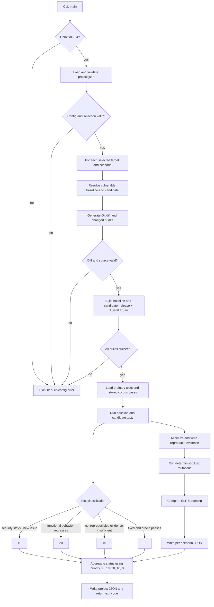

# PatchGuard Code Walkthrough

This guide describes every function in `patchguard/` and the test functions in `tests/`. **Key** marks the functions that control the main decisions and execution order.

## Execution flow

The diagram simplifies an important detail: test findings, fuzz findings, build errors, and inconclusive outcomes are all retained in the JSON. The project-level exit code is the highest-priority status among the selected scenarios.

## `patchguard/cli.py`

- **`_candidate(value)`** — Parses `TARGET=SOURCE_DIRECTORY` and rejects missing names or paths.
- **`_summary(report, output_path)`** — Renders the human-readable console report: per target and scenario status with exit code, each test verdict and reason, fuzz classifications, and hardening warnings.
- **Key — `main(argv=None)`** — Parses CLI options, checks the platform/configuration and selections, calls `evaluate_project`, writes JSON, prints the JSON pointer plus the readable summary, and returns the documented exit code. User-facing configuration or execution errors return 30.

## `patchguard/__main__.py` and `patchguard/__init__.py`

- **`__main__.py` entry point** — Imports `cli.main()` and exits with its returned status when invoked as `python -m patchguard`.
- **`__init__.py`** — Exposes the package version; it defines no functions.

## `patchguard/config.py`

- **`_need(condition, message)`** — Raises `PatchGuardError` when a configuration requirement is false.
- **`_as_number(value)` / `_as_int(value)`** — Coerce configuration scalars, returning `None` for values that are not numbers instead of raising.
- **Key — `load_project(path)`** — Reads and validates the JSON schema, workspace, targets, bundles/refs, build commands, scenarios, and test definitions, including numeric types (`timeout_seconds`, `fuzz_seed`, `fuzz_iterations`, `expected_exit`, `limits`), argv strings, `fuzz` booleans, and base64 payloads; returns normalized paths for execution. Every rejection is a `PatchGuardError`, which the CLI reports as exit code 30.
- **`test_input(test, workspace)`** — Reads test bytes from base64, a configured file, or inline text, in that precedence order.

## `patchguard/process.py`

- **`require_linux_x86_64()`** — Rejects execution outside Linux x86-64, the platform supported by this project.
- **`_expand(command, values)`** — Replaces `{workspace}`, `{source}`, and `{build}` placeholders in a command argument list.
- **Key — `build_target(target, source, workspace, build_root, mode)`** — Runs the configured release or instrumented compiler command and records command, environment, compiler version, and logs; a failed build raises `BuildError`.
- **Key — `run_program(executable, test, input_bytes, timeout_seconds, extra_env, limits)`** — Runs one test in a new process group with stdin, resource limits, captured output, and failure detection; returns a structured observation.
- **`apply_limits()`** *(nested in `run_program`)* — Sets CPU, core-dump, output-file, and open-file limits before the target starts.
- **`_decode(data)`** — Converts bytes or other values to text with replacement for invalid UTF-8. It is currently a utility and is not called by the main execution path.
- **Key — `detect_failure(returncode, stdout, stderr, timed_out)`** — Recognizes sanitizer reports, timeouts, output-limit failures, and terminating signals, including an error type where available.
- **`find_executable(name)`** — Returns an executable path from `PATH`; it is currently unused by the evaluator.

## `patchguard/diffing.py`

- **`directory_diff(before, after)`** — Gets a no-index Git diff between two source directories and parses its hunks.
- **`revision_diff(repository, before_ref, after_ref)`** — Gets the Git diff between two refs in a repository or bundle cache.
- **`parse_hunks(diff_text)`** — Extracts changed-file paths and old/new line ranges; preserves explicit zero counts for insertion/deletion hunks.
- **`_path_parts(path)`** — Normalizes slash direction and splits a path into comparable components.
- **`_matches_changed_path(source_path, changed_path)`** — Checks whether the changed path is a component-wise suffix of the compiler-reported source path, avoiding basename-only matches when directories are available.
- **`_hunk_functions(header)`** — Collects every candidate function name from a hunk header. Git echoes the full enclosing declaration, so an export macro such as `CJSON_PUBLIC(char*) cJSON_SetValuestring(...)` yields `CJSON_PUBLIC` before the real function; C keywords are filtered out and all remaining names are kept.
- **`_hunk_function(header)`** — Returns the preferred function name for reporting.
- **Key — `correlate(diff, stdout, stderr, proximity, side)`** — Extracts C/C++ stack-trace locations and matches them to the appropriate old/new hunk ranges. Direct changed-line matches are reported; nearby matches count only when the trace function is one of the names the hunk header identifies.

## `patchguard/evaluate.py`

- **`source_fingerprint(source)`** — Computes a stable SHA-256 fingerprint over source-file paths and contents, excluding `.git` entries.
- **`git_revision(source)`** — Returns a checked-out source directory’s commit hash, or `None` when it has no Git metadata.
- **`ref_revision(repository, ref)`** — Resolves a ref to a commit hash, or returns `None` if it cannot be resolved.
- **`prepare_repository(repository, cache_root)`** — Uses a directory repository directly or clones/refreshes a bare cache from a Git bundle.
- **`extract_ref(repository, ref, revision, root, role)`** — Exports a Git ref to an isolated source directory after rejecting unsafe archive paths and links.
- **`file_sha256(path)`** — Streams a file through SHA-256 for binary evidence.
- **Key — `_aggregate(codes)`** — Applies the assignment’s priority: 30, then 10, 20, 40, and finally 0, so a remaining security finding outranks a functional regression.
- **`_trim_observation(observation)`** — Bounds stdout/stderr stored in the report and marks truncated output.
- **`_run_many(executable, test, data, target, repetitions)`** — Executes the same test repeatedly and trims each observation.
- **`_failure_state(runs)`** — Returns a stable failure signature only when every repetition reports the same failure kind and error type.
- **`_failure_signature(runs)`** — Serializes every repetition’s failure kind/type, including clean runs, for later corpus validation.
- **`_safe_component(value)`** — Converts names to filesystem-safe path components.
- **`_load_regression_cases(corpus_root, target_name)`** — Loads corpus JSON, validates hashes/signatures/target, and prepares each stored case as a security test.
- **`_valid_signature(signature)`** — Checks that a saved failure signature has the expected three-run shape and value types.
- **`_find_stored_case(corpus_root, target_name, digest)`** — Returns an existing corpus file for the same target and input hash, so different seeds or scenarios cannot store the same input twice.
- **`_save_regression_case(...)`** — Writes a newly confirmed minimized input, its hash, source scenario/revision, and baseline/candidate signatures without overwriting or duplicating an existing case.
- **`_matches_expected(run, test)`** — Checks a functional run’s expected exit code and exact or contained stdout, requiring no detected failure.
- **`_correlation_state(diff, runs, side)`** — Correlates the first detected failure’s trace with the old or new diff side and attaches its failure type.
- **`_crash_site(runs)`** — Reduces a failing run to the first reported source file, line, and function so two crashes can be compared by site.
- **Key — `_evaluate_test(...)`** — Runs a test on baseline/candidate release and instrumented builds, then classifies functional behavior, security fixes, remaining flaws, new issues, or inconclusive evidence.
- **`_binary_record(executable)`** — Records the executed binary’s path, size, and SHA-256 (or why it is unavailable) for the reproducer bundle.
- **`_write_reproducer(...)`** — Minimizes a security input while preserving its failure signature, replays it, and writes JSON containing original and minimized inputs with hashes, the binary hash, command, build/runtime/host environment, commit, source fingerprint, resource limits, replay stability, and observations. Minimization is memoized in `_MINIMIZATION_CACHE` by binary SHA-256, input SHA-256, and expected finding, because the same baseline reproducer is regenerated for every scenario of a target.
- **`reproduces(candidate)`** *(nested in `_write_reproducer`)* — Reruns a minimized candidate input and accepts it only if the same failure kind/type remains.
- **Key — `_classify_fuzz_finding(baseline_runs, candidate_runs, diff)`** — Compares stable baseline and candidate failure signatures; an unstable baseline is inconclusive rather than being mislabeled as a new issue. Identical failure classes count as `VULN_REMAINS` only when the crash site matches or the candidate crash correlates with the patch; otherwise the input exposes a pre-existing defect and is recorded as `PRE_EXISTING_UNRELATED`.
- **Key — `_fuzz_candidate(...)`** — Mutates configured fuzz seeds deterministically, repeats candidate/baseline runs, minimizes findings, stores confirmed regression cases, and returns the evidence records.
- **Key — `_evaluate_scenario(...)`** — Resolves baseline/candidate sources, diffs and builds both modes, runs regular and corpus tests, fuzzes, inspects hardening, then returns one scenario report and status. Only attributed fuzz findings (`VULN_REMAINS`, `NEW_ISSUE`) contribute exit code 10; unstable and pre-existing findings stay in the report without forcing an inconclusive verdict.
- **Key — `evaluate_project(...)`** — Selects targets/scenarios, calls `_evaluate_scenario` for each, catches per-scenario configuration/execution failures, and aggregates the project report and exit code.

## `patchguard/fuzz.py` and `patchguard/minimize.py`

- **`mutate(data, rng)`** — Makes one deterministic-seed byte deletion, insertion, or replacement using a small input-oriented alphabet.
- **`minimize_bytes(original, reproduces, max_attempts)`** — Delta-debugging style minimization: starts with half-input chunks, deletes chunks whenever the predicate still reproduces the same finding, then halves the chunk size and repeats until no reduction remains or the attempt limit (200) is reached. Candidate hashes are memoized so no input is executed twice.

## `patchguard/hardening.py`

- **Key — `inspect_elf(executable)`** — Uses `readelf` to inspect PIE, NX stack, RELRO, and stack-canary properties of one binary.
- **Key — `compare_hardening(before, after)`** — Compares baseline and candidate protections and reports weakened properties as warnings.
- **`_readelf(args, executable)`** — Runs one `readelf` query and returns availability, exit status, and output.
- **`_nx_stack_from_program_headers(program_headers)`** — Determines whether the GNU_STACK program header permits execution.

## `patchguard/errors.py`

- **`PatchGuardError`** — Base exception for configuration and user-facing execution errors.
- **`BuildError.__init__(message, record)`** — Stores a readable build error and the build command/output record when available.

## Test functions

- **`ExitCodePriorityTests.test_assignment_priority()`** — Checks the required aggregate priority for codes 30, 10, 20, 40, and 0.
- **`RegressionCorpusTests.test_confirmed_finding_round_trips_and_validates()`** — Checks writing/loading a corpus case and rejecting a tampered input hash.
- **`RegressionCorpusTests.test_replay_classifies_fixed_and_still_vulnerable_cases()`** — Checks stored cases become `FIXED` or `VULN_REMAINS` from replay observations.
- **`FuzzClassificationTests.test_unstable_baseline_does_not_become_new_issue()`** — Guards against calling an issue “new” when the baseline itself fails inconsistently.
- **`DiffCorrelationTests.test_nearby_match_requires_same_function()`** — Ensures a nearby trace in another function of the same file is not treated as causal correlation.
- **`DiffCorrelationDecoratedHeaderTests.test_export_macro_in_header_still_correlates()`** — Ensures a hunk header decorated with an export macro still matches the real enclosing function (the upstream cJSON case).
- **`ElfHardeningParsingTests.test_nx_uses_gnu_stack_permissions()`** — Checks NX classification from GNU_STACK permissions, including missing-header behavior.

## Benchmark program functions

The `repository/` and `versions/` C files are readable snapshots. During evaluation, PatchGuard extracts and compiles the selected Git bundle refs; these snapshot files are not independently invoked by the evaluator.

- **`inih_bridge` — `main()`** — Reads INI text from stdin, calls the vendored parser with `on_value`, and prints the resulting stored value or returns a parse error.
- **`inih_bridge` — `on_value(...)`** — Filters accepted section/key pairs and stores the value. The vulnerable version uses unchecked `strcpy`; correct/unseen variants check length before copying; incomplete protects only one key; regression rejects a valid boundary value.
- **`capacity_reader` — `main()`** — Parses requested capacity and payload from stdin, allocates a buffer, copies/prints payload, and exits with the relevant error code. Each branch varies its overflow and boundary checks.
- **`capacity_reader` unseen branch — `add_capacity(requested, allocation_size)`** — Validates the requested size and maximum, computes the allocation size only when safe, and reports success through its return value.
- **`cjson` — `main()` in `patchguard_cjson_driver.c`** — Parses `initial|replacement` from stdin, creates a real cJSON string, calls `cJSON_SetValuestring`, and prints either the replacement or a rejection.
- **`cJSON_SetValuestring(...)` in upstream `cJSON.c`** — Updates an existing JSON string. Upstream `v1.7.17` dereferences a NULL replacement while measuring it; the upstream fix checks for NULL before calling `strlen`.

The many target-source files represent repository snapshots and patch variants; they do not mean the evaluator runs every copy in one invocation. `vendor/inih/ini.c` and the upstream cJSON sources are third-party library implementation code, so the walkthrough describes their relevant entry points rather than every upstream function.

## Interpretation note

`nearby_line` is included in `related` only when both the sanitizer frame and Git hunk identify the same function. Frames from a different function in the same source file are no longer treated as correlation evidence. Reports include the trace function, hunk function, path, line, and relation so the reviewer can assess the link. Hunk headers often repeat the whole declaration (`CJSON_PUBLIC(char*) cJSON_SetValuestring(...)`), so every identifier that precedes an opening parenthesis is considered, with C keywords removed, instead of trusting only the first one.
